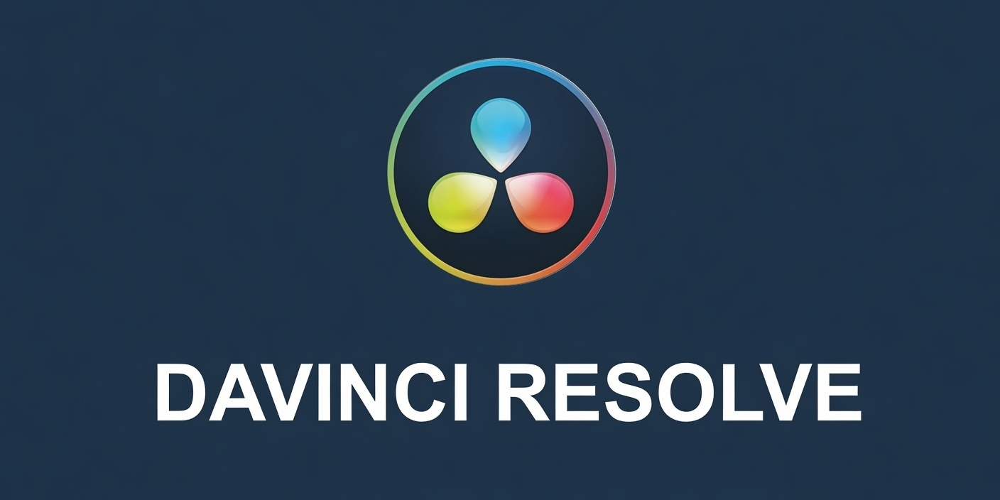

<h1 align="center">🎬 DaVinci Resolve for Windows — Video Tool</h1>

  

---

Turn a folder of clips into a finished film inside one application, without shuttling between a cutter, a compositor, a grading suite, and a DAW. Resolve gathers the entire post-production chain — media management, Cut and Edit timelines, Fusion compositing, the Color page with its scopes, Fairlight audio, and Deliver — behind a single launch. You import once, switch pages as the work demands, and render from the same project you just graded.

## ✅ Before You Start

- **Windows 10 / 11** (64-bit) — macOS and Linux builds exist too
- **16 GB RAM minimum**, 32 GB is comfortable for 4K and Fusion work
- **A GPU with OpenCL 1.2 or CUDA 11+** and at least 4 GB of VRAM
- **About 4 GB of free disk** before cache and proxies
- **An internet connection** to download the installer
- **Administrator rights** for installation

## Features

**🎬 Seven Pages, One Project**
Media, Cut, Edit, Fusion, Color, Fairlight, Deliver — each page is a room in the same house, and your timeline follows you between them. Import a clip once and every tool in the chain sees it; no exports to move work from one department to the next.

**✂️ A Cut Page Built for Speed**
Source tape lets you rip through hours of footage in one stream, the sync bin lines up multicam angles by timecode, and fast review trims a rough assembly before you commit to detail. When the story is in place, jump to Edit and refine without re-importing a thing.

**🎞️ Edit Page Precision**
Three-point editing, ripple and roll trims, slip and slide, and a trim viewer that shows both sides of a cut at once. Multicam, nested timelines, keyframed transforms, and Fusion titles sit where an editor expects them — the frame stays in view while your hands stay on the keys.

**🖥️ Fusion Compositing, Brought In-House**
A full node-based compositor lives inside the same application: 3D workspace, particles, planar and point tracking, keying, and paint. Pull a green screen, build a title animation, or extend a set without a round trip to another program and another render.

**🎨 Color That Holds Up Under Scrutiny**
Primaries, curves, qualifiers, Power Windows, and a node graph that lets you build a grade the way you think about it. HDR grading, scopes that tell the truth, LUT support, and frame-accurate tracking keep the look consistent from the first shot to the last.

**🎚️ Fairlight Audio in the Same Timeline**
A mixing console, channel strips, EQ and dynamics, and FairlightFX plug-ins attached to the clips you already cut. Dialogue, music, and effects land on the same timeline as picture, so the mix is never a separate delivery problem.

**🗂️ A Media Pool That Keeps Order**
Smart bins, metadata columns, and search that reads the tags you actually use. Generate proxies and optimized media in the background, and let Resolve decide which version of a clip to play so the timeline stays responsive on modest hardware.

**⚡ Deliver Without Surprises**
A render queue that keeps working while you keep editing, presets for YouTube, Vimeo, broadcast, and archive masters, and the option to render individual clips or the whole timeline. What you previewed is what lands in the output file.

**🧩 One Install, Everything Included**
Editor, compositor, color tools, and audio console ship in a single package and check themselves on first launch. No plug-in scavenger hunt, no "missing codec" the night before delivery — install once and start working.

**🪟 At Home on Windows x64**
Hardware-accelerated playback through the GPU, shortcuts that match the platform, and multi-monitor layouts that remember where you parked the scopes and the mixer.

## How it works

Think of it as one application that opens onto a project manager instead of a blank canvas. The installer lays down the editing engine, the Fusion compositor, the color pipeline, and the Fairlight console as a single unit, then points them all at the same project database. On first launch it checks the GPU, builds the cache folders, and creates a default project library — all locally, with no account gate in the way.

From there the project is a container for everything: media, timelines, grades, node graphs, and audio mixes. The Media page brings footage in and writes metadata; Cut and Edit assemble it; Fusion and Color work on the same clips; Fairlight mixes against the same picture. Because the pages share one timeline, a change in one place is visible everywhere else the moment you switch back.

Under the hood, Resolve separates playback from rendering. Optimized media and proxies are generated in the background, previews are cached per clip, and heavy effects wait for the render queue. The result is a desktop post-production loop that feels continuous — ingest, assemble, grade, mix, deliver — with no cloud round-trips and no dependency on anything outside your own machine.

## Workflow

Start with the ingest. Drop footage into the Media page, let Resolve read the metadata, and sort clips into bins by scene, camera, or day. Generate proxies right away if the source is 4K or heavier — the timeline will thank you later.

Assemble a rough cut. On the Cut page, run the source tape and mark the moments that matter; on the Edit page, trim, ripple, and reorder until the story holds. Lay music underneath early, so the rhythm of the cut comes from the track rather than from guesswork.

Build the visuals. Stack tracks for picture-in-picture and split screens, add titles and lower thirds, then step into Fusion when a shot needs more than a transition — a key, a clean-up, a tracked overlay. The node graph stays attached to the clip, so revisions are a matter of reopening the comp.

Grade the sequence. Balance shots against each other with primaries, isolate a face or a sky with a qualifier or a Power Window, and track it when the camera moves. Build the look in nodes so it can be copied across scenes instead of rebuilt shot by shot.

Mix the sound. Balance dialogue against music, ride levels with the console, duck the bed under speech, and check the mix on the meters before you trust your ears. Sync narration to picture and preview the whole sequence in real time.

Deliver when it feels right. Pick a preset or build your own, review the final pass, and queue the render. Export a master for archive and a compressed version for the platform — both from the same timeline, without a second setup.

## FAQ

### 🎬 Do I need the paid Studio version?
The free build covers editing, Fusion, color, and Fairlight for most personal and small-team work. Studio adds the neural-engine tools, advanced noise reduction, and higher-resolution delivery for commercial pipelines. Start free; upgrade when a specific tool becomes the bottleneck.

### 🧩 Where do my projects and media live?
Projects sit in a local database on your drive, and the media stays wherever you keep it — Resolve links to files rather than copying them. Keep footage on a fast internal disk, and back up the project database the same way you back up your footage.

### ⚡ Can I compare a grade before committing it?
Yes. The Color page shows before-and-after views, and stills let you store a grade and flip between versions instantly. Nodes stay editable, so a look is never baked in until you render it.

### 🖥️ Is Fusion a separate application?
No — it's a page inside Resolve. You can work on a clip in Fusion and return to the timeline with the comp still attached. Standalone Fusion exists for VFX-only work, but the integrated page is what keeps the round trip out of your day.

### 🔄 What does a typical pass look like?
Ingest and organize, rough cut, visual effects and titles, grade, mix, then deliver. The pages are ordered that way for a reason, but nothing stops you from jumping back — recording a fix in Fusion after the grade is normal, not a detour.

### 🗂️ Will my project open on another machine?
A project archive carries the timeline, grades, and comps with it; media has to travel separately. Export the project, copy the media with the same folder structure, and relink on the other machine. Databases can be moved too, but archives are the safer route for handoff.

### 🧠 How much RAM and GPU should I budget?
4K editing is comfortable at 16 GB, Fusion and HDR grading want 32 GB, and heavy noise reduction rewards more VRAM than raw memory. Close background apps during long renders, and render in segments when a timeline gets dense.

### 🛠️ What if a page won't open or the GPU errors out?
Confirm the install finished and the GPU driver is current — most page failures trace back to an outdated driver. If a single page misbehaves, restart Resolve once; if it persists, check the GPU preference in settings and try the other processing mode before reinstalling.

## License

DaVinci Resolve is commercial software from Blackmagic Design, and the license is the rulebook for your edit bay rather than a locked door. The free build is licensed for use as-is; Studio is licensed per seat through an activation key or a USB dongle. Install it on the machines you work on, cut, grade, mix, and deliver — personal and commercial projects alike. What you create with it stays yours; the license covers the software, not your footage.

Treat the installer as a workshop pass: it travels with each legitimate copy, stays on your own workstations, and folds into your pipeline however your workflow demands. What it doesn't allow is redistribution — don't repackage the installer as your own product, don't resell access to it, and don't strip or alter the licensing and activation components inside the package. Keep attribution and trademark notices intact where they appear.

If your team grows, each additional seat needs its own legitimate copy — set up new stations from the official installer, the way you'd duplicate a project template: cleanly, from the source, never from hand-me-down installs. Internal templates, LUTs, and node presets you build are yours to reuse; shipping a modified build as a competing product is not.

Bottom line: install it, edit with it, deliver your reels, films, and mixes — just don't turn the installer into merchandise. The workflow is yours; the build stays whole.

---

*DaVinci Resolve and Fusion are trademarks of Blackmagic Design. This page is an unofficial overview and is not affiliated with or endorsed by Blackmagic Design.*
